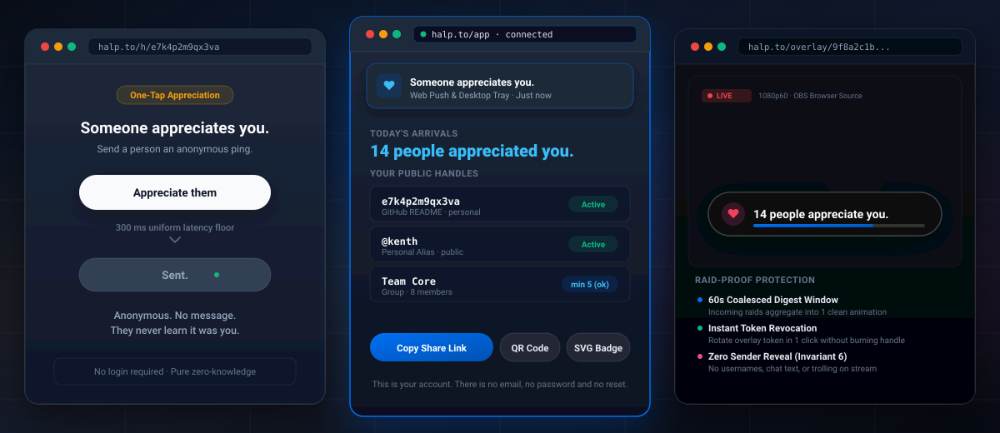
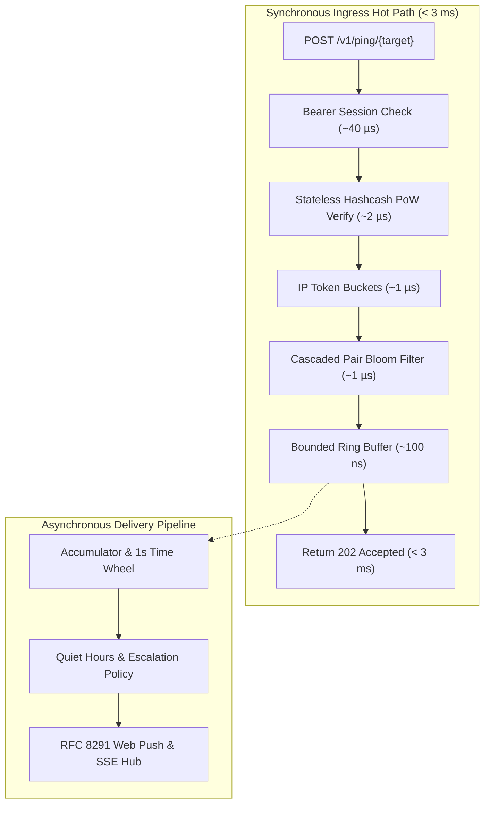

# Halp — Someone appreciates you.

<p align="center">
  <a href="https://github.com/halpworld/halpcheers/actions/workflows/ci.yml"></a>
  <a href="LICENSE"></a>
  <a href="docs/PRIVACY.md"></a>
  <a href="docs/OPERATIONS.md"></a>
  <a href="https://halp.to"></a>
</p>

Saying "thank you" on the internet is broken. Direct messages demand conversation, creating an awkward obligation to reply. Public likes, upvotes, and leaderboards turn genuine gratitude into a popularity contest. Comment sections invite trolls and unsolicited advice. Because of this friction, most everyday appreciation is left unsaid.

**Halp does one thing, and nothing else, ever:** it lets anyone send you an anonymous *"Someone appreciates you."* ping in a single tap. No text to write, no sender name attached, no inbox to manage, and no social pressure to reply. Just a quiet, warm tap on the shoulder that says: **what you made mattered to someone today.**

<p align="center">
  
</p>

---

## See It in Action

Halp works seamlessly across the web, desktop tray, and command-line terminal:

<p align="center">
  
  <br />
  <em>Terminal recording recorded directly with <a href="https://github.com/charmbracelet/vhs">VHS</a> using <a href="docs/assets/halp-tui.tape">docs/assets/halp-tui.tape</a>.</em>
</p>

---

## How People Use Halp

### 1. Put a 1-Click "Appreciate" Badge on Your GitHub README or Blog

Drop a clean, lightweight badge right into your open-source project's `README.md`, personal blog, or newsletter footer:

<p align="center">
  <a href="https://halp.to"></a>
</p>

```markdown
[](https://halp.to/h/e7k4p2m9qx3va)
```

**What happens when a reader clicks it?**
A minimal, fast page opens (working smoothly even with JavaScript disabled). The visitor taps **"Send appreciation"**, and you receive a gentle notification on your desktop, phone, or terminal. They don't need to sign up, type a message, or give up their email. It takes less than two seconds.

### 2. Send & Receive From Your Terminal (`halp`)

If you live in the terminal, you can interact with Halp without ever touching a web browser:

```bash
# Send anonymous appreciation to a friend's handle or @alias
halp send @alice
halp send e7k4p2m9qx3va

# Or leave the live, real-time TUI running in a tmux pane
halp
```

The TUI connects over Server-Sent Events (SSE) to deliver incoming appreciation with an optional terminal bell (`\a`), clean Lip Gloss styling, and zero CPU usage when idle.

### 3. Appreciate Teammates in a Private Group

Create a private group for your engineering team, design squad, or study circle.

To protect everyone's privacy, group-scoped appreciation requires a minimum of **5 members**. Once your group reaches 5 people, teammates can send anonymous appreciation pings to each other through team handles (`e-group-handle`). It lifts team morale and recognizes quiet wins without office politics, performative praise, or peer pressure.

### 4. Raid-Proof Appreciation for Live Streamers (OBS + Twitch / YouTube)

Add Halp as an **OBS Browser Source** (`https://halp.to/overlay/<your-token>`) and run `halp-bot` in your Twitch or YouTube Live chat (`!cheers`, `!appreciate`, `!halp`).

* **Intelligent Coalescing:** If 50 viewers hit your link or chat command during an epic play, Halp automatically combines them into a single, calm toast: **"50 people appreciate you."** It never plays 50 deafening sound alerts or clutters your screen.
* **Instant Token Revocation:** If you accidentally display your overlay token on stream, rotate it with one tap in your settings. The old overlay immediately terminates within 2 seconds while your public handle stays unchanged.

---

## Try It Locally in 30 Seconds

### With Docker (Full Web App + Server + Reverse Proxy)

Test the complete Halp stack on your local machine with Docker Compose:

```bash
git clone https://github.com/halpworld/halpcheers.git
cd halpcheers
docker compose up -d --build
```

Open your browser to:
* **Landing Page:** [http://localhost/](http://localhost/)
* **Web App (PWA):** [http://localhost/app](http://localhost/app) *(Claim your 16-digit account key & create handles)*
* **Public Share Page:** `http://localhost/h/<your-handle>`
* **OBS Stream Overlay:** `http://localhost/overlay/<your-overlay-token>`
* **Backend Health Check:** [http://127.0.0.1:8080/healthz](http://127.0.0.1:8080/healthz)

> [!NOTE]
> Modern web browsers treat `http://localhost` as a **Secure Context**. Full WebCrypto key generation, Web Workers, and Web Push notifications function locally with zero self-signed TLS warnings.

### From the Terminal (Native Go, Zero Dependencies)

Prefer running from source? Halp compiles cleanly with `CGO_ENABLED=0`:

```bash
# 1. Start the backend daemon (listens on :8080)
go run ./server/cmd/halpd

# 2. In another terminal, launch the interactive Bubble Tea TUI
go run ./tui/cmd/halp --server http://127.0.0.1:8080

# 3. Or send a ping directly via CLI
go run ./tui/cmd/halp --server http://127.0.0.1:8080 send <handle>
```

---

## Built So You Never Have to Trust Us

Privacy at Halp is not a policy or a marketing promise — it is enforced by mathematics and system architecture:

* **No message history exists:** There is no `messages` or `pings` table in the database. Once an appreciation ping is dispatched to your device, it vanishes from server memory forever. Under subpoena or seizure, we cannot produce what does not exist.
* **Your identity as a sender is never revealed:** Senders are anonymous to recipients, to the server, and to anyone sniffing the network. There are no accounts linked to emails, no sender IDs in API payloads, and no "de-anonymize" tiers.
* **Your account key never leaves your device:** Your account is protected by a 16-digit cryptographically random key. When you log in, your device derives an authentication secret via HKDF; the raw key is never sent over the wire. Even your address book of saved contacts is encrypted client-side with AES-256-GCM before syncing.
* **Built-in protection against spam & harassment:** Every send requires a stateless proof-of-work grind, strictly rate-limiting botnets. A sender can send at most 3 pings per 24 hours to the same person. Quiet hours, daily digest policies, and instant handle pause/burn controls ensure you are always in complete control.
* **Tiny & self-hostable:** The server is a single static Go binary and one local SQLite file running in WAL mode. No Redis, no Kafka, no external dependencies. It comfortably handles 1,200 requests/second on a $10/month VPS.

---

## Deploy Your Own Server

Halp is designed to run in a single EU region (`eu-1`) under strict GDPR data residency:

```bash
HALP_DOMAIN=your-domain.com \
HALP_VAPID_SUBSCRIBER=mailto:ops@your-domain.com \
docker compose up -d --build
```

For complete host kernel tuning, systemd configurations, and automated SQLite WAL backup runbooks, see [`docs/OPERATIONS.md`](docs/OPERATIONS.md).

---

<details>
<summary><strong>Under the Hood: Architecture, Invariants & Full Specification Docs</strong></summary>

<br />

### Request Path & Synchronous Latency Budget

Every ping received at `POST /v1/ping/{target}` is validated, enqueued to a bounded non-blocking ring buffer, and returns `202 Accepted` in **under 3 ms** (`p50: 0.11 ms`, `p99: 1.23 ms`), completely decoupled from downstream push services:



### The 9 Non-Negotiable Invariants

All development in Halp is governed by the 9 non-negotiable invariants set out in [`AGENTS.md`](AGENTS.md):

| # | Invariant | Architectural Principle | How It Is Enforced |
|---|---|---|---|
| **1** | **No message records** | No `messages`, `pings`, `history`, or `events` tables exist anywhere. | Dynamic schema traversal in `redteam/TestStorageAudit` proves `blocks` is the sole disk table exception. |
| **2** | **No sync push calls in HTTP handler** | Handler enqueues to an in-memory channel in ~100 ns; never awaits push, disk, or DNS. | Latency verified by `loadtest/` and non-blocking timeout assertions in `server/internal/http/ping_test.go`. |
| **3** | **No heavy frameworks** | Pure Go stdlib + `chi` router + `modernc.org/sqlite` + Prometheus. Zero ORMs, zero reflection DI. | Static binary build (`CGO_ENABLED=0`), dependency audits, and scratch container validation. |
| **4** | **Token lifecycle hygiene** | Subscriptions pruned only on authoritative rejection (`404`/`410`) where `created_day <= send_start_day`. | Pruning queries in `server/internal/push/` require timestamp guard, preventing mid-flight re-registration races. |
| **5** | **Abuse prevention ships with feature** | Any new reachability surface lands together with its rate limits, token buckets, and revocation paths. | Validated in `redteam/TestHarassmentScenario` across handles, groups, and OBS overlays. |
| **6** | **Never reveal the sender** | Senders are anonymous to recipients and server. Zero sender data in UI, API responses, or GDPR exports. | Tested in `redteam/TestDeAnonymisationAttempt` ensuring `GET /v1/account/export` contains 0 sender fields. |
| **7** | **Enforcement invisible to sender** | Valid, rate-limited, blocked, paused, and unknown handles return byte-identical `202 Accepted` with uniform timing. | Two-sample Kolmogorov-Smirnov distribution test in `loadtest/` verifies indistinguishable timing CDFs. |
| **8** | **Fixed-size allocations for inputs** | Bloom filters, caches, Count-Min sketches, and queues are sized at startup from configuration. | Memory ceilings asserted under 10k burst pings in `redteam/TestAvailabilityAttempt`. |
| **9** | **No identifiers in logs/metrics** | No handles, account IDs, aliases, IPs, subscription URLs, or user agents appear in log lines or metric labels. | Automated AST static analyzer (`go run ./server/cmd/check-invariant9 ./server`) run as a blocking CI gate. |

### Complete Architectural Documentation Map

| Document | Purpose & Contents |
| --- | --- |
| [`AGENTS.md`](AGENTS.md) | The 9 Non-Negotiable Invariants and context rules for contributors and AI agents |
| [`CONTRIBUTING.md`](CONTRIBUTING.md) | Open-source contribution workflow, frozen contracts, and PR checklists |
| [`SECURITY.md`](SECURITY.md) | Vulnerability disclosure SLA and cryptographic key hierarchy |
| [`CHANGELOG.md`](CHANGELOG.md) | Version history following Keep-a-Changelog and Semantic Versioning |
| [`CODE_OF_CONDUCT.md`](CODE_OF_CONDUCT.md) | Contributor Covenant v2.1 code of conduct and community impact guidelines |
| [`docs/ARCHITECTURE.md`](docs/ARCHITECTURE.md) | System shape, request path latency budget, capacity headroom, and tunables |
| [`docs/IDENTITY.md`](docs/IDENTITY.md) | Account keys, Crockford base32 handles, aliases, and lifecycle rules |
| [`docs/ABUSE.md`](docs/ABUSE.md) | The defence stack: Hashcash PoW, token buckets, Bloom cascades, and abuse mutes |
| [`docs/DELIVERY.md`](docs/DELIVERY.md) | Transports, coalescing time wheel, quiet hours, and digest policy |
| [`docs/DISCOVERY.md`](docs/DISCOVERY.md) | Finding people, client contacts, and why there is no lookup endpoint |
| [`docs/GROUPS.md`](docs/GROUPS.md) | Teams, group-scoped handles, roster membership, and minimum group size floor |
| [`docs/SHARING.md`](docs/SHARING.md) | Sharing links, SVG badges, client-side QR codes, and OBS overlays |
| [`docs/TRANSPARENCY.md`](docs/TRANSPARENCY.md) | Public transparency report, warrant canary, and architectural impossibility proofs |
| [`docs/OPERATIONS.md`](docs/OPERATIONS.md) | Host tuning, Caddy configuration, zero-identifier logging, WAL backup runbooks |
| [`docs/PRIVACY.md`](docs/PRIVACY.md) | GDPR posture, data inventory, and rights reconciliation |
| [`docs/API.md`](docs/API.md) | Wire protocol, HTTP API surface, and SQLite schema migrations |
| [`docs/UI.md`](docs/UI.md) | User interface and UX specification: verbatim copy, button states, and screen checklists |
| [`docs/ROADMAP.md`](docs/ROADMAP.md) | Phasing, deliverables, and permanently excluded non-goals |
| [`docs/AGENT-WORKFLOW.md`](docs/AGENT-WORKFLOW.md) | Parallel development rules, directory ownership map, and frozen contract waves |
| [`docs/OPEN-QUESTIONS.md`](docs/OPEN-QUESTIONS.md) | Architectural decision log (`## Decided`) preserving rationale for decisions 1–50 |
| [`docs/RELEASE.md`](docs/RELEASE.md) | Release pipeline, code signing, Apple notarization, and key custody runbook |

### Running the Test & Verification Suites

```bash
# Unit, integration, and race tests across all Go modules
go test -race ./server/... ./tui/... ./redteam/... ./loadtest/...

# Static AST analyzer enforcing Invariant 9 (zero identifier leaks in logs/formatters)
go run ./server/cmd/check-invariant9 ./server
go run ./server/cmd/check-invariant9 ./tui

# Hostile red-team adversarial suite (exercises botnets, de-anonymization, & enumeration)
go test -v -race ./redteam/...

# Capacity load test harness (sustained 1,200 RPS & 10k burst test)
go run ./loadtest -target http://localhost:8080 -rps 1200
```

</details>

---

## Platforms & Availability

Halp is available across a unified suite of open-source clients:
* **Web:** Progressive Web App (PWA) with Web Push service worker.
* **Browser Extensions:** Manifest V3 extensions for Google Chrome and Mozilla Firefox.
* **Desktop App:** Native desktop application for macOS, Windows, and Linux built with Tauri v2.
* **Terminal:** Pure Go TUI client (`tui/cmd/halp`) with Bubble Tea and CLI send mode.
* **Streaming & Chat:** OBS Browser Source overlay (`/overlay/{token}`) and Twitch/YouTube chat bot (`halp-bot`).

*Safari & Mobile:* Web Push inside Safari Web Extensions was deliberately excluded due to platform unreliability ([Decision 1](docs/OPEN-QUESTIONS.md#decided)); Safari users are served via the Web App (over Safari Web Push) and the native macOS desktop app. Mobile platforms (iOS and Android) are reserved for Phase 4 under `mobile/`.

---

## License

Halp is open-source software licensed under the [Apache License, Version 2.0](LICENSE).
