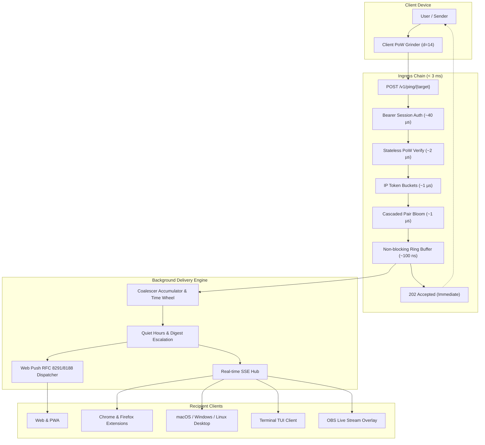

# Halp

> **Send a person an anonymous 'someone appreciates you' ping. Nothing else, ever.**

[](https://github.com/halpworld/halpcheers/actions/workflows/ci.yml)
[](LICENSE)
[](go.work)
[](docs/PRIVACY.md)
[](docs/OPERATIONS.md)

---

## Why Halp Exists & Core Philosophy

Halp is an ultra-lightweight, privacy-first notification utility with exactly one function: let a person send another person an anonymous appreciation ping. No text, no images, no reason, no sender identity. One fixed idea, delivered.

* **Zero payload.** The notification content is constant: *"Someone appreciates you."* There is nothing to write, nothing to read, nothing to moderate, and nothing to weaponize.
* **Anonymous to the recipient.** The recipient never learns who appreciated them. Anonymity is guaranteed by mathematics and architecture, not merely promises.
* **Zero message history.** Nothing is stored about a ping once it is dispatched. There is no `messages`, `pings`, `history`, `events`, or `audit_log` table anywhere in the system. Producing sender logs or retroactive surveillance records is an architectural impossibility.
* **Small and self-hosted.** The server is a single Go binary (`halpd`) plus one SQLite database in Write-Ahead Logging (WAL) mode, hosted in a single European region (`eu-1`). It runs comfortably on a $10–20/month VPS.

---

## Architecture Overview

Halp is engineered for high throughput, sub-3ms synchronous ingress, and complete decoupling between ping acceptance and background push delivery.



### Request Path Latency Budget

Every step on the synchronous HTTP ping handler is bounded in memory and CPU to guarantee Invariant 2 (< 3 ms response ceiling):

| Request Stage | Operation | Budget / Measured Time | Implementation Detail |
| --- | --- | --- | --- |
| **1. Auth** | Bearer session lookup | `~40 µs` | In-memory session validation, zero disk I/O |
| **2. Proof-of-Work** | Stateless Hashcash verify | `~2 µs` | Stack-allocated buffer, `sha256.Sum256`, 0 allocations |
| **3. Rate Limiting** | In-memory token bucket | `~1 µs` | Atomic decrement, sliding window per IP |
| **4. Deduplication** | Cascaded Bloom filter | `~1 µs` | Directional check across rotating daily slots |
| **5. Enqueue** | Bounded channel send | `~100 ns` | Non-blocking Go channel (`select { case ch <- job: ... default: drop }`) |
| **Total Ingress** | **`POST /v1/ping/{target}`** | **`< 3 ms`** *(p50: 0.11 ms, p99: 1.23 ms)* | **Returns `202 Accepted` with empty body** |
| **Async Pipeline** | Coalesce & Delivery | Off hot path | Accumulator + 1s time wheel -> Web Push / SSE |

---

## The 9 Non-Negotiable Invariants

All development in Halp is governed by the 9 non-negotiable invariants set out in [`AGENTS.md`](AGENTS.md):

| # | Invariant | Architectural Principle | How It Is Enforced in Code & CI |
|---|---|---|---|
| **1** | **No message records** | No `messages`, `pings`, `history`, or `events` tables exist. Once dispatched, a ping is gone forever. | Dynamic schema traversal in `redteam/` `TestStorageAudit` proves `blocks` is the sole disk table exception. |
| **2** | **Never make synchronous push calls in HTTP handler** | `POST /v1/ping/{target}` validates, enqueues to an in-memory channel, and returns `202` in `< 3 ms`. Never awaits push, disk, or DNS. | Latency verified by `loadtest/` and non-blocking timeout assertions in `server/internal/http/ping_test.go`. |
| **3** | **No heavy frameworks** | Pure Go stdlib + `chi` router + `modernc.org/sqlite` + Prometheus. Zero ORMs, zero reflection DI. | Static binary build (`CGO_ENABLED=0`), dependency audits, and scratch container validation. |
| **4** | **Token lifecycle hygiene** | Prune push subscriptions strictly on authoritative rejection (`404`/`410`) where `created_day <= send_start_day`. | Pruning queries in `server/internal/push/` require timestamp guard, preventing mid-flight re-registration races. |
| **5** | **Abuse prevention ships with the feature** | Any new reachability surface lands together with its rate limits, token buckets, and revocation paths. | Validated in `redteam/TestHarassmentScenario` across handles, groups, and OBS overlays. |
| **6** | **Never reveal the sender** | Senders are anonymous to recipients and the server. No sender identity exists in UI, API responses, or GDPR exports. | Tested in `redteam/TestDeAnonymisationAttempt` ensuring `GET /v1/account/export` contains 0 sender fields. |
| **7** | **Enforcement is invisible to sender** | Rate-limited, deduped, blocked, paused, and non-existent targets return byte-identical `202 Accepted` with uniform timing. | Two-sample Kolmogorov-Smirnov distribution test in `loadtest/` verifies indistinguishable timing CDFs. |
| **8** | **Fixed-size allocations for user inputs** | Bloom filters, caches, Count-Min sketches, and queues are sized at startup from configuration. | Memory ceilings asserted under 10k burst pings in `redteam/TestAvailabilityAttempt`. |
| **9** | **No identifiers in logs or metrics** | No handles, account IDs, aliases, IPs, subscription URLs, or user agents appear in log lines or metric labels. | Automated AST static analyzer (`go run ./server/cmd/check-invariant9 ./server`) run as a blocking CI gate. |

---

## Ecosystem & Platforms Matrix

Halp is engineered as a unified ecosystem of lightweight clients and interfaces:

| Component | Path / Route | Technology | Purpose & Capabilities |
| --- | --- | --- | --- |
| **Server Daemon** | `server/cmd/halpd` | Pure Go (`CGO_ENABLED=0`) | Ingress router, Hashcash PoW, SQLite WAL, Web Push RFC 8291, SSE Hub |
| **Web SDK** | `web/core` | Vanilla TypeScript | Typed API client, WebCrypto HKDF key separation, Web Worker Hashcash PoW |
| **Web App / PWA** | `web/app` | Vanilla TS, Web Push SW | Responsive send/receive interface, pure client-side SVG QR code generator |
| **Browser Extension** | `extension/` | Manifest V3 (Chrome, Firefox) | Real-time SSE badge counter while popup open, background alarm sync |
| **Desktop App** | `desktop/` | Tauri v2, Rust, Webview | Native tray app (macOS, Windows, Linux) with OS keychain credential storage |
| **Terminal Client** | `tui/cmd/halp` | Go, Bubble Tea, Lip Gloss | Interactive Elm-architecture TUI client & non-interactive `halp send` CLI |
| **Chat Bot** | `tui/cmd/halp-bot` | Pure Go IRCv3 client | Twitch & YouTube Live chat bot bridging chat commands to anonymous pings |
| **OBS Overlay** | `/overlay/{token}` | Server-Sent Events, HTML5 | Streamer Browser Source with revocable tokens and 2-second watchdog loop |

---

## Test It Locally in 30 Seconds

### Option 1: Full-Stack Docker Compose (Recommended)

The easiest way to test the complete Halp stack locally is with Docker Compose. This spins up the Go server daemon (`halpd`) alongside the Caddy reverse proxy, which enforces Invariant 9 by stripping client IPs and headers.

```bash
# Clone the repository
git clone https://github.com/halpworld/halpcheers.git
cd halpcheers

# Build and start the complete local stack
docker compose up -d --build
```

Once running, access the local endpoints immediately:
* **Landing Page:** [http://localhost/](http://localhost/)
* **Web App (PWA):** [http://localhost/app](http://localhost/app)
* **Share Link:** `http://localhost/h/<handle>`
* **OBS Browser Source Overlay:** `http://localhost/overlay/<token>`
* **Backend Health Check:** [http://127.0.0.1:8080/healthz](http://127.0.0.1:8080/healthz)

> [!NOTE]
> **Zero TLS Warnings:** Modern web browsers treat `http://localhost` as a **Secure Context**. Full WebCrypto key generation, Web Workers, and Web Push APIs function locally out of the box without self-signed certificate friction.

### Option 2: Native Go + Node Dev Mode

Run components directly on your host machine:

```bash
# 1. Start the server daemon (listens on :8080)
go run ./server/cmd/halpd

# 2. Launch the interactive Go TUI client in another terminal
go run ./tui/cmd/halp

# 3. Or send an anonymous ping via CLI
go run ./tui/cmd/halp send <target-handle>

# 4. Run the Twitch / YouTube chat bot reading from stdin
go run ./tui/cmd/halp-bot --target <target-handle>

# 5. Build frontend packages
npm --prefix web/core ci && npm --prefix web/core run build
npm --prefix web/app ci && npm --prefix web/app run build
```

---

## Verification & Test Suites

Halp maintains comprehensive automated test coverage enforcing all invariants:

```bash
# Run unit and integration tests across all Go modules under race detector
go test -race ./server/... ./tui/... ./redteam/... ./loadtest/...

# Run AST static analyzer enforcing Invariant 9 (zero identifier leaks in logs/formatters)
go run ./server/cmd/check-invariant9 ./server
go run ./server/cmd/check-invariant9 ./tui

# Run hostile red-team adversarial suite (exercises botnets, de-anonymization, & enumeration)
go test -v -race ./redteam/...

# Run capacity load test harness (sustained 1,200 RPS & burst test)
go run ./loadtest -target http://localhost:8080 -rps 1200
```

---

## Production VPS Deployment (`eu-1`)

Halp is designed to run in a single European region (`eu-1`) under GDPR jurisdiction. Deploying to a $10–20/month VPS (e.g. Hetzner CX22/CX32 in Falkenstein or Helsinki) requires just three steps:

1. **Host Preparation:** Tune kernel file descriptors (`fs.file-max = 2097152`, `nofile = 65536`) and TCP socket recycling per [`docs/OPERATIONS.md`](docs/OPERATIONS.md).
2. **Launch with Environment:**
   ```bash
   HALP_DOMAIN=halp.to \
   HALP_VAPID_SUBSCRIBER=mailto:ops@halp.to \
   docker compose up -d --build
   ```
3. **Verify Service Health:**
   ```bash
   curl -fsS http://127.0.0.1:8080/healthz
   # Output: ok
   ```

Refer to [`docs/OPERATIONS.md`](docs/OPERATIONS.md) for complete systemd units, automated SQLite WAL backup scripts, and Prometheus scraping configurations.

---

## Complete Documentation & Specification Map

The documentation in [`docs/`](docs/) is the definitive architectural specification for the project:

| Document | Description |
| --- | --- |
| [`AGENTS.md`](AGENTS.md) | The 9 Non-Negotiable Invariants and context rules for contributors and AI agents |
| [`CONTRIBUTING.md`](CONTRIBUTING.md) | Open-source contribution workflow, frozen contracts, and PR checklists |
| [`SECURITY.md`](SECURITY.md) | Vulnerability disclosure SLA and cryptographic key hierarchy |
| [`CHANGELOG.md`](CHANGELOG.md) | Version history following Keep-a-Changelog and Semantic Versioning |
| [`CODE_OF_CONDUCT.md`](CODE_OF_CONDUCT.md) | Contributor Covenant v2.1 code of conduct and community impact guidelines |
| [`docs/ARCHITECTURE.md`](docs/ARCHITECTURE.md) | System shape, request path latency budget, capacity headroom, and tunables |
| [`docs/IDENTITY.md`](docs/IDENTITY.md) | Account keys, Crockford base32 handles, aliases, and lifecycle rules |
| [`docs/ABUSE.md`](docs/ABUSE.md) | The defence stack: Hashcash PoW, token buckets, Bloom cascades, and abuse mutes |
| [`docs/DELIVERY.md`](docs/DELIVERY.md) | Transports, coalescing time wheel, quiet hours, and digest policy |
| [`docs/DISCOVERY.md`](docs/DISCOVERY.md) | Finding people, client contacts, and why there is no lookup endpoint |
| [`docs/GROUPS.md`](docs/GROUPS.md) | Teams, group-scoped handles, roster membership, and minimum group size floor |
| [`docs/SHARING.md`](docs/SHARING.md) | Sharing links, SVG badges, client-side QR codes, and OBS overlays |
| [`docs/TRANSPARENCY.md`](docs/TRANSPARENCY.md) | Public transparency report, warrant canary, and architectural impossibility proofs |
| [`docs/OPERATIONS.md`](docs/OPERATIONS.md) | Host tuning, Caddy configuration, zero-identifier logging, WAL backup runbooks |
| [`docs/PRIVACY.md`](docs/PRIVACY.md) | GDPR posture, data inventory, and rights reconciliation |
| [`docs/API.md`](docs/API.md) | Wire protocol, HTTP API surface, and SQLite schema migrations |
| [`docs/UI.md`](docs/UI.md) | User interface and UX specification: verbatim copy, button states, and screen checklists |
| [`docs/ROADMAP.md`](docs/ROADMAP.md) | Phasing, deliverables, and permanently excluded non-goals |
| [`docs/AGENT-WORKFLOW.md`](docs/AGENT-WORKFLOW.md) | Parallel development rules, directory ownership map, and frozen contract waves |
| [`docs/OPEN-QUESTIONS.md`](docs/OPEN-QUESTIONS.md) | Architectural decision log (`## Decided`) preserving rationale for decisions 1–50 |
| [`docs/RELEASE.md`](docs/RELEASE.md) | Release pipeline, code signing, Apple notarization, and key custody runbook |

---

## Platforms

All planned Phase 1, Phase 2, and Phase 3 platforms are implemented and verified:
* **Web:** Progressive Web App (PWA) with Web Push service worker.
* **Browser Extensions:** Manifest V3 extensions for Google Chrome and Mozilla Firefox.
* **Desktop App:** Native desktop application for macOS, Windows, and Linux built with Tauri v2.
* **Terminal:** Pure Go TUI client (`tui/cmd/halp`) with Bubble Tea and CLI send mode.
* **Streaming & Chat:** OBS Browser Source overlay (`/overlay/{token}`) and Twitch/YouTube chat bot (`halp-bot`).

*Note on Safari:* Web Push inside Safari Web Extensions was deliberately excluded due to platform unreliability ([Decision 1](docs/OPEN-QUESTIONS.md#decided)); Safari users are served via the Web App (over Safari Web Push) and the native macOS desktop app. Mobile platforms (iOS and Android) are reserved for Phase 4 under `mobile/`.

---

## Licence

Halp is open-source software licensed under the [Apache License, Version 2.0](LICENSE).
